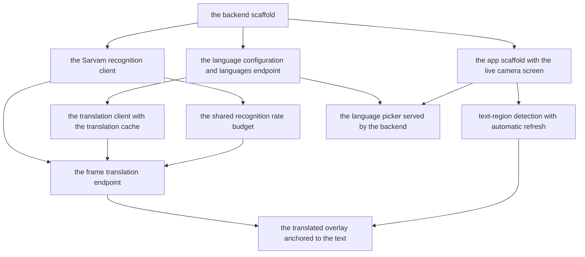

# Tasks — camera translate overlay

Epic: genai-jerry/mirror#2. One task is one pull request, ordered so every
merge onto the epic branch leaves it releasable. The backend comes first
because it owns the contract the app consumes; the app follows. This is a new
repository with no code, so the first backend task and the first app task
each scaffold their project, and the design (gate G2) chooses the stack
before any of them starts.

Sub-issue numbers live in each task's section below.

## Dependency order

## Task 1 — Backend scaffold

- [x] Status: on the epic branch
- Repo: genai-jerry/mirror
- Sub-issue: #4
- Depends on: nothing
- Serves scenarios: none directly — every backend task builds on it

Create the backend proxy service project in the stack the approved design
chooses, with one passing test and a health endpoint. In the same PR, set
`stack`, `commands` (test, build, lint — each one a command this task ran)
and `conventions` in `.factory/profile.json`.

## Task 2 — Language configuration and the languages endpoint

- [x] Status: on the epic branch
- Repo: genai-jerry/mirror
- Sub-issue: #5
- Depends on: Task 1 (the backend scaffold)
- Serves scenarios:
  - language-configuration / Adding a new source language (backend side)
  - language-configuration / Provider changed for a language

A backend configuration source that lists the supported source and target
languages and maps each source language to its recognition and translation
provider, plus an endpoint that returns that list to the app. Changing the
configuration changes what the endpoint returns, with no app release.
Malayalam is the first source language in the shipped configuration.

## Task 3 — Sarvam recognition client

- [x] Status: on the epic branch
- Repo: genai-jerry/mirror
- Sub-issue: #6
- Depends on: Task 1 (the backend scaffold)
- Serves scenarios:
  - translate-proxy-service / Successful translation request (the recognition step)

A backend module that sends a cropped image to Sarvam's document recognition
(submit, poll, download), and returns the recognized text and where it sits
in the image. The Sarvam API key is read from backend configuration and never
leaves the backend.

## Task 4 — Translation client with the translation cache

- [x] Status: on the epic branch
- Repo: genai-jerry/mirror
- Sub-issue: #7
- Depends on: Task 2 (the language configuration and languages endpoint)
- Serves scenarios:
  - translate-proxy-service / Same headline seen again
  - translate-proxy-service / Successful translation request (the translation step)

A backend module that translates recognized text using the provider the
configuration maps to the language pair, with a short-lived cache keyed by a
hash of the source text. Text already translated and still in the cache is
answered from the cache, with no provider call.

## Task 5 — Shared recognition rate budget

- [x] Status: on the epic branch
- Repo: genai-jerry/mirror
- Sub-issue: #8
- Depends on: Task 3 (the Sarvam recognition client)
- Serves scenarios:
  - translate-proxy-service / Rate budget exhausted

A limiter around all outgoing recognition calls, shared across every user,
with the per-minute budget read from backend configuration (the values are
plan-dependent — see the proposal). A request past the budget waits or is
deferred; the backend never exceeds the configured limit.

## Task 6 — Frame translation endpoint

- [x] Status: in review
- Repo: genai-jerry/mirror
- Sub-issue: #9
- Depends on: Task 3 (the Sarvam recognition client), Task 4 (the translation
  client with the translation cache), Task 5 (the shared recognition rate
  budget)
- Serves scenarios:
  - translate-proxy-service / Successful translation request
  - translate-proxy-service / Same headline seen again (end to end)
  - translate-proxy-service / Rate budget exhausted (end to end)

The one endpoint the app calls: accepts a cropped image with a source and
target language, runs recognition under the rate budget, translates through
the cache, and returns the recognized text, its translation and a region
hint. Images are discarded after the response; nothing is stored but the
cache entry.

## Task 7 — App scaffold with the live camera screen

- [x] Status: on the epic branch
- Repo: genai-jerry/mirror
- Sub-issue: #10
- Depends on: Task 1 (the backend scaffold — the two scaffolds edit
  `.factory/profile.json` in turn, not at once)
- Serves scenarios: none directly — the camera-translate-capture scenarios
  build on it

Create the Android app project in the stack the approved design chooses,
showing a live camera preview, with one passing test. In the same PR, extend
`commands` in `.factory/profile.json` so test, build and lint cover both the
backend and the app.

## Task 8 — Text-region detection with automatic refresh

- [x] Status: on the epic branch
- Repo: genai-jerry/mirror
- Sub-issue: #11
- Depends on: Task 7 (the app scaffold with the live camera screen)
- Serves scenarios:
  - camera-translate-capture / Headline changes

On-device detection of text regions in the camera view, tracking where each
region sits on screen, and a periodic refresh cycle that crops the detected
region and hands it on — automatically, with no tap, at a cadence that
respects the backend's rate budget.

## Task 9 — Translated overlay anchored to the text

- [x] Status: in review
- Repo: genai-jerry/mirror
- Sub-issue: #12
- Depends on: Task 6 (the frame translation endpoint), Task 8 (text-region
  detection with automatic refresh)
- Serves scenarios:
  - camera-translate-capture / Text detected and translated
  - camera-translate-capture / Overlay stays while refresh is pending
  - camera-translate-capture / Backend call times out

Each refresh cycle sends the cropped region to the frame translation endpoint
and draws the translated text anchored to the tracked region. While a cycle
is pending, and when a cycle fails or times out, the last good overlay stays
on screen — never a blank, never an error state.

## Task 10 — Language picker served by the backend

- [x] Status: on the epic branch
- Repo: genai-jerry/mirror
- Sub-issue: #13
- Depends on: Task 2 (the language configuration and languages endpoint),
  Task 7 (the app scaffold with the live camera screen)
- Serves scenarios:
  - language-configuration / Adding a new source language (app side)

An in-app picker for the source and target language, filled from the
languages endpoint, with the chosen pair used for the session's translation
requests. A language added to the backend configuration appears in the picker
with no app update.

## Task 11 — Test data loader (#15)

- [x] Status: in review
- Repo: genai-jerry/mirror
- Sub-issue: #15
- Depends on: Task 2 (the language configuration and languages endpoint),
  Task 5 (the shared recognition rate budget)
- Serves scenarios: none directly — it loads the system test data sets the
  cases in `system-tests/test-plan.md` use

Opened by the Test Planner (exempt from the ~10-task cap). Build a loader so
that a `load` command applies this epic's backend configuration sets (DS-2
language configurations, DS-3 low recognition budget) from
`system-tests/data/` into a running backend, and an `unload` command removes
them and restores the shipped configuration — both idempotent, so a second
load does not duplicate or stack. The repo has no `test_data` block in
`.factory/profile.json` yet: add it (`load`, `unload`, `format`) in the same
PR, each command one this task ran, and fill in the `## Loading` section of
`system-tests/test-data.md`.

## Scenario coverage

Every scenario in `specs/` maps to at least one task:

| Capability | Scenario | Covered by |
|---|---|---|
| camera-translate-capture | Text detected and translated | the translated overlay anchored to the text |
| camera-translate-capture | Overlay stays while refresh is pending | the translated overlay anchored to the text |
| camera-translate-capture | Headline changes | text-region detection with automatic refresh |
| camera-translate-capture | Backend call times out | the translated overlay anchored to the text |
| translate-proxy-service | Successful translation request | the frame translation endpoint (with the Sarvam recognition client and the translation client) |
| translate-proxy-service | Same headline seen again | the translation client with the translation cache |
| translate-proxy-service | Rate budget exhausted | the shared recognition rate budget |
| language-configuration | Adding a new source language | the language configuration and languages endpoint; the language picker served by the backend |
| language-configuration | Provider changed for a language | the language configuration and languages endpoint |
