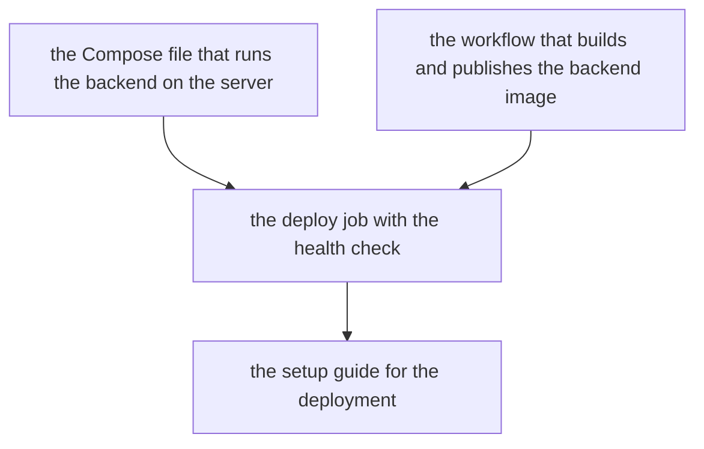

# Tasks — backend deployment

Epic: genai-jerry/mirror#37. One task is one pull request, ordered so every
merge onto the epic branch leaves it releasable. The Compose file and the
build-and-publish workflow can land in either order; the deploy job needs
both, because it ships the image the workflow published using the Compose
file the server runs; the setup guide comes last, once every secret and
variable name is settled by the code it documents.

This epic changes no backend code: every task adds deployment files or
documents. Docker is not installed on the factory's runners, so no task can
run a real deploy; a person runs the first deploy by hand, following the
setup guide (the proposal's verification limit).

Sub-issue numbers live in each task's section below.

## Dependency order

## Task 1 — Compose file that runs the backend on the server

- [ ] Status: not started
- Repo: genai-jerry/mirror
- Sub-issue: #39
- Depends on: nothing
- Serves scenarios:
  - backend-deployment / Settings reach the container (the wiring the deploy job fills)
  - backend-deployment / Redeploy keeps configuration (the volume)

A Docker Compose file the server runs: one backend container from a
published image tag, the runtime-configuration directory on a volume that
survives restarts and redeploys, and the backend's settings
(`SARVAM_API_KEY`, `ADMIN_TOKEN`, `APP_TOKEN`) passed in from the
environment. Port 8000 is exposed plainly. No server address or secret value
appears in the file.

## Task 2 — Workflow that builds and publishes the backend image

- [ ] Status: not started
- Repo: genai-jerry/mirror
- Sub-issue: #40
- Depends on: nothing
- Serves scenarios:
  - backend-deployment / Other branches and pull requests
  - backend-deployment / Documents-only push
  - backend-deployment / Manual run (the trigger)
  - backend-deployment / Image published before deploy
  - backend-deployment / Build fails

A GitHub Actions workflow that, on a push to `staging` or `main` that
changes the backend or the deployment files — and on a manual start for a
chosen branch — builds the backend's Docker image from `backend/Dockerfile`
with `backend/` as the build context and publishes it to GitHub Container
Registry tagged with the commit it was built from. No deploy runs for other
branches, pull requests, or pushes that touch only documents, the Android
app or the factory's files. A failed build fails the run before any server
is contacted.

## Task 3 — Deploy job that ships the image to the branch's server and checks its health

- [ ] Status: not started
- Repo: genai-jerry/mirror
- Sub-issue: #41
- Depends on: Task 1 (the Compose file), Task 2 (the build-and-publish workflow)
- Serves scenarios:
  - backend-deployment / Push to staging
  - backend-deployment / Push to main
  - backend-deployment / Manual run (the deploy)
  - backend-deployment / Changing a server
  - backend-deployment / Missing secret
  - backend-deployment / Required key missing
  - backend-deployment / Settings reach the container
  - backend-deployment / Secrets stay out of sight
  - backend-deployment / Redeploy keeps configuration
  - backend-deployment / Redeploy replaces the old container
  - backend-deployment / Healthy deploy
  - backend-deployment / Unhealthy deploy
  - backend-deployment / Two pushes in quick succession

The deploy half of the workflow: after the image is published, connect to
the branch's server over SSH — `staging` to the staging server, `main` to
the production server — using the address, user, key and port held as
secrets in that branch's GitHub Environment, and start the published tag
with the Compose file so exactly one backend container runs and the old one
is replaced. Before contacting the server the run fails, naming the secret,
if any required secret (including `SARVAM_API_KEY`) is missing. After
starting it the run checks `GET /healthz` and fails if it does not answer
healthy in time; a success names the environment and image tag deployed.
Two deploys to the same environment never run at once. No secret value
appears in the log.

## Task 4 — Setup guide for the deployment

- [ ] Status: not started
- Repo: genai-jerry/mirror
- Sub-issue: #42
- Depends on: Task 3 (the deploy job)
- Serves scenarios:
  - backend-deployment / Complete list of secrets and variables
  - backend-deployment / Preparing a server

A setup guide in the repository that lists every secret and variable the
deployment and the backend read — name, which environment (`staging` or
`production`), required or optional, and what it is for — and walks a
person through preparing a new Linux server (what must be installed, how to
create and authorise the SSH key) and running the first deploy by hand,
confirming it with the health check.

## Scenario coverage

Every scenario in `specs/backend-deployment/spec.md` is served by at least
one task:

| Scenario | Task |
|---|---|
| Push to staging | the deploy job |
| Push to main | the deploy job |
| Other branches and pull requests | the build-and-publish workflow |
| Documents-only push | the build-and-publish workflow |
| Manual run | the build-and-publish workflow and the deploy job |
| Image published before deploy | the build-and-publish workflow |
| Build fails | the build-and-publish workflow |
| Changing a server | the deploy job |
| Missing secret | the deploy job |
| Settings reach the container | the Compose file and the deploy job |
| Required key missing | the deploy job |
| Secrets stay out of sight | the deploy job |
| Redeploy keeps configuration | the Compose file and the deploy job |
| Redeploy replaces the old container | the deploy job |
| Healthy deploy | the deploy job |
| Unhealthy deploy | the deploy job |
| Two pushes in quick succession | the deploy job |
| Complete list of secrets and variables | the setup guide |
| Preparing a server | the setup guide |
