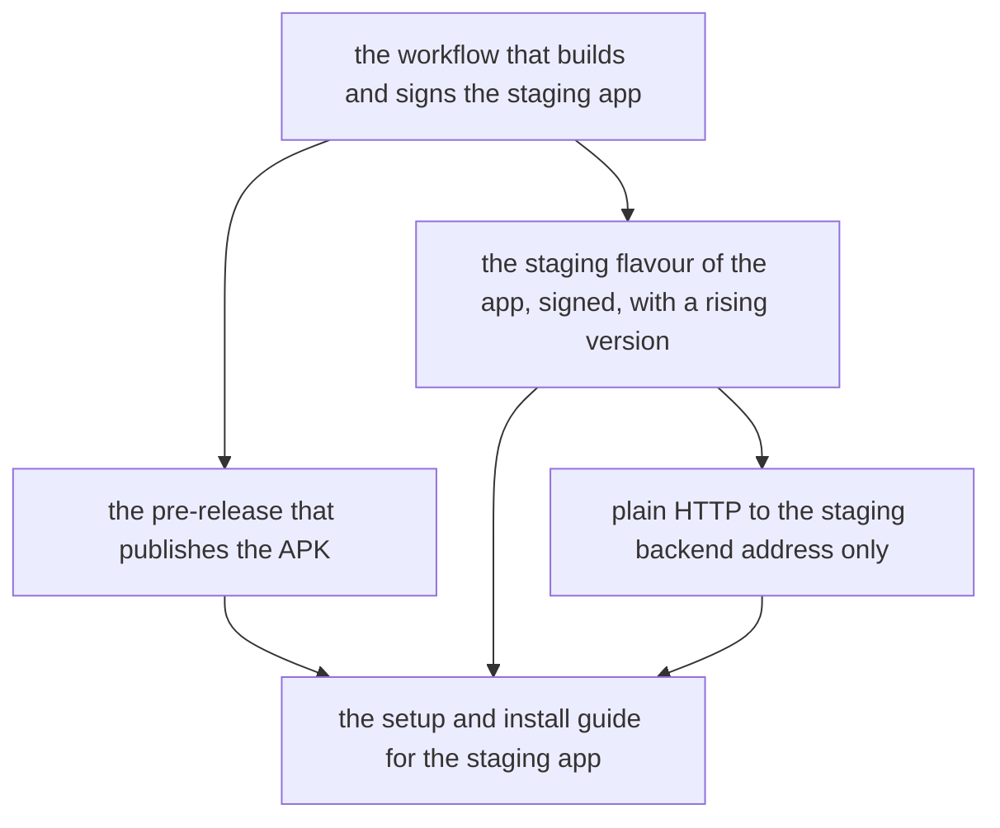

# Tasks — installable staging Android app

Epic: genai-jerry/mirror#61. One task is one pull request, ordered so every
merge onto the epic branch leaves it releasable. The workflow comes first in
two halves — the build job, then the pre-release that publishes what it
built — because the workflow fixes the names the app's build reads: the
secrets, the build properties and the version number. The app's staging
flavour then matches those names, the plain-HTTP rule builds on the flavour,
and the guide comes last, once every secret and step is settled by the code
it documents.

This epic changes nothing the app does on screen: two tasks add a flavour
and a network rule to the app's build, two add a workflow, one adds a guide.
The factory's runners have no Android SDK, so no task can run a real build;
the workflow tasks prove their triggers and shell steps the way the backend
deploy's tests do, and a person runs the first real build by hand, following
the guide (the proposal's verification limit).

## Before the app tasks can start

The app lives on `staging` (the mirror v1 epic is there) but not on `main`,
and this epic's branch was cut from `main`, so `app/` is not on the branch
yet. It arrives when the mirror v1 epic's production pull request is merged
and the factory merges `main` into every live epic branch. Until then:

- the workflow tasks and their tests can be built, reviewed and assembled;
- the staging flavour task and the plain-HTTP task cannot start. An
  implementer that finds no `app/` on the branch stops and says so.

Sub-issue numbers live in each task's section below.

## Dependency order

## Task 1 — Workflow that builds and signs the staging app

- [x] Status: done
- Repo: genai-jerry/mirror
- Sub-issue: #64
- Depends on: nothing
- Serves scenarios:
  - staging-app-distribution / App change pushed to staging
  - staging-app-distribution / Push that does not touch the app
  - staging-app-distribution / Other branches and pull requests
  - staging-app-distribution / Manual run (the trigger and the branch check)
  - staging-app-distribution / App not on the branch yet
  - staging-app-distribution / Failed build publishes nothing (the build job fails)
  - staging-app-distribution / Changing the staging backend (the address is read at build time)
  - staging-app-distribution / Token switch on (the token is passed into the build)
  - staging-app-distribution / Missing backend secret
  - staging-app-distribution / New build installs over the old one (the rising version number)
  - staging-app-distribution / Missing signing secret
  - staging-app-distribution / Build log and notes (the log)

The build half of a new GitHub Actions workflow. It runs on a push to
`staging` that changes the app or the workflow itself, and on a manual start
on `staging` only; it runs for no other branch, no pull request and no push
that touches only documents, the backend or the deployment files. Before
building it fails, naming the file, if the app is not on the branch, and
fails, naming each missing secret, if the staging backend address or any
signing secret is not set. It then sets up a JDK and the Android SDK, runs
the app's unit suite, builds the staging flavour of the app signed with the
test key from the secrets, passes the backend address, the app token and a
version number that rises with every run into the build, and keeps the APK
for the publish job. A failed suite or build fails the run. No secret value
appears in the log. Comes with workflow tests beside the backend deploy's
(`.github/workflow-tests/`), proving the triggers and the shell steps
without an Android SDK.

## Task 2 — Pre-release that publishes the APK

- [x] Status: done
- Repo: genai-jerry/mirror
- Sub-issue: #65
- Depends on: Task 1 (the workflow that builds and signs the staging app)
- Serves scenarios:
  - staging-app-distribution / Manual run (the publish)
  - staging-app-distribution / Pre-release created
  - staging-app-distribution / Not marked as a production release
  - staging-app-distribution / Failed build publishes nothing (the publish job needs the build job)
  - staging-app-distribution / Build log and notes (the notes)

The publish half of the workflow: a job that runs only after the build job
succeeds and creates a new GitHub pre-release on this repository with the
signed APK attached. Each pre-release has its own tag and name built from
the version number, is marked as a pre-release and is never marked as the
repository's latest release. Its notes name the commit and the app version
it was built from, and nothing else: no backend address, no token, no key.
A failed build job means no pre-release. Comes with workflow tests for the
job order, the pre-release flags and the notes.

## Task 3 — Staging flavour of the app, signed, with a rising version

- [x] Status: done
- Repo: genai-jerry/mirror
- Sub-issue: #66
- Depends on: Task 1 (the workflow that builds and signs the staging app),
  and the app being on the epic branch (see above)
- Serves scenarios:
  - staging-app-distribution / App reaches the staging backend
  - staging-app-distribution / Changing the staging backend
  - staging-app-distribution / Token switch on
  - staging-app-distribution / New build installs over the old one
  - staging-app-distribution / Other builds unchanged (the flavours)

A third flavour of the app, `staging`, beside `dev` and `systemTest`. Its
backend address and app token come from build properties the workflow
passes in, never from a file in the repository, so changing the address
secret changes the build with no code change. A release build of this
flavour is signed with the test key the workflow provides, and its version
number comes from a build property, so each staging build is higher than
the last and installs over it as an update. The `dev` and `systemTest`
flavours are unchanged, and the gate's commands (the dev unit suite, the
debug build, lint) still pass with none of the staging properties set.

## Task 4 — Plain HTTP to the staging backend address only

- [x] Status: done
- Repo: genai-jerry/mirror
- Sub-issue: #67
- Depends on: Task 3 (the staging flavour of the app)
- Serves scenarios:
  - staging-app-distribution / Plain HTTP staging backend
  - staging-app-distribution / Any other plain HTTP server
  - staging-app-distribution / Other builds unchanged (the network rules)

The network rules of the staging flavour: plain HTTP is allowed to the
staging backend's host, taken from the same build property as the backend
address, and refused to every other address. The `dev` and `systemTest`
flavours keep their current list of allowed local addresses and gain no
others. A unit test proves the staging rule holds for the configured host
and for no other.

## Task 5 — Setup and install guide for the staging app

- [ ] Status: open
- Repo: genai-jerry/mirror
- Sub-issue: #68
- Depends on: Task 2 (the pre-release), Task 3 (the staging flavour),
  Task 4 (the plain-HTTP rule)
- Serves scenarios:
  - staging-app-distribution / Owner sets up the build
  - staging-app-distribution / Tester installs the app

A guide under `docs/`, linked from the README, with four parts: every secret
the build reads (name, what it holds, required or optional); how to create
the test signing key and turn it into the secrets; how to run the build by
hand on `staging` and find the pre-release; and how a tester signed in to
GitHub on an Android phone downloads the APK from the newest pre-release
and installs it, including installing a newer build over an older one.
Written so an owner needs to read neither the workflow nor the build file.

## Scenario coverage

Every scenario in `specs/staging-app-distribution/spec.md` is served by at
least one task:

| Scenario | Task |
|---|---|
| App change pushed to staging | the build workflow |
| Push that does not touch the app | the build workflow |
| Other branches and pull requests | the build workflow |
| Manual run | the build workflow and the pre-release |
| App not on the branch yet | the build workflow |
| Pre-release created | the pre-release |
| Not marked as a production release | the pre-release |
| Failed build publishes nothing | the build workflow and the pre-release |
| App reaches the staging backend | the staging flavour |
| Changing the staging backend | the build workflow and the staging flavour |
| Token switch on | the build workflow and the staging flavour |
| Missing backend secret | the build workflow |
| Plain HTTP staging backend | the plain-HTTP rule |
| Any other plain HTTP server | the plain-HTTP rule |
| Other builds unchanged | the staging flavour and the plain-HTTP rule |
| New build installs over the old one | the build workflow and the staging flavour |
| Missing signing secret | the build workflow |
| Build log and notes | the build workflow and the pre-release |
| Owner sets up the build | the setup and install guide |
| Tester installs the app | the setup and install guide |
